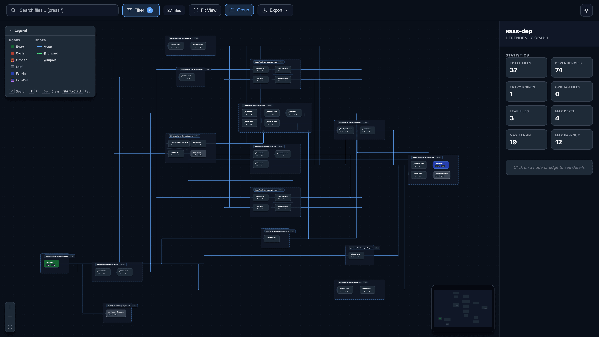

[](./Cargo.toml)
[](#overview)
[](https://github.com/emiliodominguez/sass-dep/actions/workflows/ci.yml)
[](./LICENSE)

**Understand how your SCSS files connect.**

Map dependencies, find circular imports and check architecture rules with a Rust CLI and an interactive graph visualizer.

## Overview

`sass-dep` parses SCSS files to extract `@use`, `@forward`, and `@import` directives, resolves paths according to Sass conventions, and builds a directed dependency graph that can be analyzed for cycles, metrics, impact and architecture rules.

## Features

- **Fast** - Single-pass byte scanner, parallel graph construction and cached directory listings: ~20k files / 120k imports analyzed in well under a second
- **Sass-accurate resolution** - Partials, index files, `.import.scss` files, explicit extensions, CSS modules, load paths and webpack-style `~package` imports
- **Cycle detection** - Tarjan SCCs decomposed into ordered, real import cycles (self-imports included)
- **Metrics** - Fan-in, fan-out, depth, transitive dependencies and transitive dependents (blast radius)
- **CI checks** - Cycles, depth/fan limits, orphans, unresolved imports, legacy `@import` and custom architecture rules, with text, JSON or GitHub annotation output
- **Impact analysis** - `impact` lists every file and entry point affected by a change; `why` explains how a file is reached
- **Multiple output formats** - JSON (versioned schema), Graphviz DOT, Mermaid and D2
- **Interactive web visualizer** - React-based UI embedded in the binary



## Installation

```bash
git clone https://github.com/emiliodominguez/sass-dep.git
cd sass-dep
./setup.sh                  # git hooks + builds the web visualizer (needs npm)
cargo install --path .
```

Or directly from GitHub (the visualizer is embedded only if `web/dist` was built first; everything else works without it):

```bash
cargo install --git https://github.com/emiliodominguez/sass-dep
```

## Quick Start

```bash
# Create .sass-dep.toml with auto-detected entry points
sass-dep init

# Analyze (entry points from the config, or pass them explicitly)
sass-dep analyze src/main.scss -o deps.json

# Explore interactively
sass-dep analyze --web

# Enforce constraints in CI
sass-dep check --no-cycles --no-unresolved --max-depth 10

# Which bundles does this change affect?
sass-dep impact $(git diff --name-only main) --format json

# Why is this file part of the build?
sass-dep why src/components/_button.scss
```

## CLI Reference

### Global Options

| Option              | Short | Description                                                 |
| ------------------- | ----- | ----------------------------------------------------------- |
| `--root <DIR>`      |       | Project root directory (default: `.`)                       |
| `--config <FILE>`   |       | Config file (default: `<root>/.sass-dep.toml` when present) |
| `--load-path <DIR>` | `-I`  | Add Sass load path, relative to `--root` (repeatable)       |
| `--quiet`           | `-q`  | Suppress non-error output                                   |
| `--verbose`         | `-v`  | `-v`: timings and all unresolved imports                    |

Entry points can be given as arguments or via `entry_points` in the config file. File IDs in every output are paths relative to `--root`, with `/` separators.

### `analyze`

Build the dependency graph and output the analysis.

```bash
sass-dep analyze [OPTIONS] [ENTRY_POINTS]...
```

| Option              | Short | Description                                             |
| ------------------- | ----- | ------------------------------------------------------- |
| `--output <FILE>`   | `-o`  | Output file (default: stdout)                           |
| `--format <FORMAT>` |       | `json` (default), `dot`, `mermaid` or `d2`              |
| `--include-orphans` |       | Also include files not reachable from any entry point   |
| `--web`             |       | Start the interactive visualizer                        |
| `--port <PORT>`     |       | Visualizer port (default: 3000; next free port if busy) |
| `--no-open`         |       | Do not open the browser automatically                   |

```bash
sass-dep analyze src/app.scss src/admin.scss            # multiple entry points
sass-dep analyze -I node_modules src/main.scss          # with load paths
sass-dep analyze src/main.scss --format dot | dot -Tsvg > deps.svg
sass-dep analyze src/main.scss --web --port 8080
```

Orphan discovery honours `.gitignore`/`.ignore`, skips hidden files and `node_modules`, and parses the orphans too, so their own dependencies show up in the graph.

### `check`

Verify graph integrity and architecture rules. Exits with code `1` on violations. Flags are merged with the `[check]` and `[[rules]]` config sections.

```bash
sass-dep check [OPTIONS] [ENTRY_POINTS]...
```

| Option                | Description                                              |
| --------------------- | -------------------------------------------------------- |
| `--no-cycles`         | Fail on circular dependencies                            |
| `--max-depth <N>`     | Maximum depth in the dependency tree                     |
| `--max-fan-out <N>`   | Maximum direct dependencies per file                     |
| `--max-fan-in <N>`    | Maximum direct dependents per file                       |
| `--no-orphans`        | Fail on files unreachable from every entry point         |
| `--no-unresolved`     | Fail on imports that cannot be resolved                  |
| `--no-legacy-imports` | Fail on `@import` (deprecated, removed in Dart Sass 3.0) |
| `--format <FORMAT>`   | `text` (default, stderr), `json` or `github` (stdout)    |

```bash
sass-dep check --no-cycles --max-depth 10 --max-fan-out 15 src/main.scss
```

GitHub Actions annotations:

```yaml
- run: sass-dep check --format github
```

### `impact`

List every file and entry point that (transitively) depends on the given files. Non-Sass paths are ignored, so a raw `git diff` works.

```bash
sass-dep impact [OPTIONS] <FILES>...    # --entry/-e <FILE> (repeatable), --format text|json
```

### `why`

Print the shortest import chain from an entry point to a file.

```bash
$ sass-dep why src/base/_typography.scss -e main.scss
main.scss
└─ @use (line 1) → base/_index.scss
   └─ @forward (line 2) → base/_typography.scss
```

### `export`

Convert a saved JSON analysis (any 1.x schema) to `dot` (default), `mermaid` or `d2`. Use `-` to read from stdin and `-o` to write to a file.

```bash
sass-dep export analysis.json --format mermaid > graph.mmd
sass-dep analyze src/main.scss | sass-dep export - --format d2 | d2 - graph.svg
```

### `init`

Write a starter `.sass-dep.toml`. Entry points are detected as non-partial files that nothing else imports. `--force` overwrites an existing file.

## Configuration

`.sass-dep.toml` in the project root (or `--config <FILE>`). Every key is optional; CLI flags take precedence; unknown keys are rejected.

```toml
entry_points = ["src/main.scss", "src/admin.scss"]
load_paths = ["node_modules"]        # relative to the project root
extensions = ["scss", "sass"]        # resolution order
include_orphans = true
exclude = ["**/legacy/**"]           # skipped during orphan discovery

[thresholds]                         # flags are set when value >= threshold
high_fan_in = 5
high_fan_out = 10

[check]
no_cycles = true
no_unresolved = true
no_legacy_imports = false
no_orphans = false
max_depth = 10
max_fan_out = 15
max_fan_in = 30

# Architecture rules: files matching `from` must not import files matching `deny`.
# Globs match file IDs; `*` stays within a directory, `**` crosses directories.
[[rules]]
name = "components are page-agnostic"
from = "src/components/**"
deny = ["src/pages/**", "src/layouts/**"]
allow = ["src/pages/_tokens.scss"]   # optional exceptions
message = "Move shared styles to src/shared"
```

## Resolution

Resolution mirrors Dart Sass's filesystem importer, and CI checks it file-for-file against Dart Sass on Bootstrap, Bulma, Foundation and Angular Material (`scripts/sass-parity.sh`). For `@use "foo"` in `src/main.scss`, first next to the importing file, then in each load path:

1. `foo.scss`, `_foo.scss`, `foo.sass`, `_foo.sass` — these must match **exactly one** file; several matches are an ambiguity (reported in `analysis.unresolved` with a `reason`, as Dart Sass refuses to compile it)
2. otherwise `foo.css` / `_foo.css`
3. otherwise `foo/index.*` / `foo/_index.*` with the same rules

`@import` first tries import-only files (`foo.import.scss`, also with an explicit extension). Targets are URLs: `?query`/`#fragment` are ignored and `%XX` is decoded; `"."`, `".."` and `"foo/"` only resolve to index files. Paths are lexical, so a symlinked file resolves its own imports relative to the link, exactly like Dart Sass. `"~pkg/path"` is looked up in the load paths and then in `node_modules` directories walking up from the importing file.

Skipped on purpose: built-in modules (`sass:math`), `pkg:` URLs, plain CSS imports (`url(...)`, `*.css`, remote URLs, interpolated URLs, imports with media queries, `supports()` or `layer()`), and `@import` inside plain `.css` files. Anything else that fails to resolve is reported as a warning and in `analysis.unresolved`.

## JSON Schema

`analyze` output follows a versioned schema — [`schema/v1.1.0.json`](schema/v1.1.0.json). Nodes are sorted by ID and edges by `(from, to)`, so the output is diff-friendly.

```json
{
  "$schema": "https://raw.githubusercontent.com/emiliodominguez/sass-dep/main/schema/v1.1.0.json",
  "version": "1.1.0",
  "metadata": {
    "generated_at": "2026-01-15T10:30:00Z",
    "root": "/project",
    "sass_dep_version": "0.2.0",
    "entry_points": ["src/main.scss"]
  },
  "nodes": {
    "src/main.scss": {
      "path": "/project/src/main.scss",
      "metrics": {
        "fan_in": 0,
        "fan_out": 3,
        "depth": 0,
        "transitive_deps": 5,
        "transitive_dependents": 0
      },
      "flags": ["entry_point"]
    }
  },
  "edges": [
    {
      "from": "src/main.scss",
      "to": "src/_variables.scss",
      "directive_type": "use",
      "location": { "line": 1, "column": 1 },
      "namespace": "vars",
      "configured": false
    }
  ],
  "analysis": {
    "cycles": [["src/_a.scss", "src/_b.scss"]],
    "unresolved": [
      {
        "from": "src/main.scss",
        "target": "missing",
        "directive_type": "use",
        "location": { "line": 4, "column": 1 }
      }
    ],
    "statistics": {
      "total_files": 10,
      "total_dependencies": 15,
      "entry_points": 1,
      "orphan_files": 2,
      "leaf_files": 4,
      "max_depth": 5,
      "max_fan_in": 3,
      "max_fan_out": 4,
      "cycle_count": 1,
      "unresolved_imports": 1,
      "import_directives": 0
    }
  }
}
```

- `depth` is `null` for files unreachable from every entry point.
- Each cycle is an ordered closed path: `cycle[i]` imports `cycle[i + 1]` and the last file imports the first. Every `in_cycle` file appears in at least one cycle.
- `transitive_deps` / `transitive_dependents` count files reachable from / reaching a file; files in a cycle count themselves.
- Changes from 1.0.0: nullable `depth` (was `usize::MAX`), plus the `transitive_dependents`, `entry_points`, `unresolved`, `cycle_count`, `unresolved_imports` and `import_directives` fields. `export` and the visualizer still read 1.0.0 files.

### Node Flags

| Flag           | Description                             |
| -------------- | --------------------------------------- |
| `entry_point`  | File specified as an entry point        |
| `leaf`         | File with no dependencies (fan-out = 0) |
| `orphan`       | File not reachable from any entry point |
| `high_fan_in`  | Fan-in ≥ threshold (default: 5)         |
| `high_fan_out` | Fan-out ≥ threshold (default: 10)       |
| `in_cycle`     | File is part of a circular dependency   |

### Edge Types

| Type      | Description                  |
| --------- | ---------------------------- |
| `use`     | `@use` directive             |
| `forward` | `@forward` directive         |
| `import`  | `@import` directive (legacy) |

## Library Usage

```rust
use sass_dep::{Analyzer, DependencyGraph, OutputSchema, Resolver};

let root = std::path::Path::new(".").canonicalize()?;
let resolver = Resolver::default();
let mut graph = DependencyGraph::new();
graph.build_from_entry(&root.join("src/main.scss"), &resolver, &root)?;
Analyzer::default().analyze(&mut graph);

let schema = OutputSchema::from_graph(&graph, &root);
```

## Exit Codes

| Code | Description                        |
| ---- | ---------------------------------- |
| 0    | Success                            |
| 1    | `check` found violations           |
| 2    | Invalid arguments or configuration |
| 3    | File not found or IO error         |
| 4    | Parse error                        |

## Web Visualizer

The project includes an interactive web-based visualizer for exploring dependency graphs. It can be launched directly from the CLI or run standalone from the `web/` directory.

### Running the Visualizer

**Option 1: Integrated with CLI (recommended)**

```bash
# Analyze and launch visualizer in one command
sass-dep analyze src/main.scss --web

# Custom port
sass-dep analyze src/main.scss --web --port 8080
```

The browser will open automatically at `http://localhost:3000` with your analysis data loaded.

**Option 2: Standalone Development**

```bash
cd web
npm install
npm run dev
```

Open `http://localhost:5173` and load your JSON analysis file (drag & drop or file picker).

### Visualizer Features

**Graph Interaction**

- Pan and zoom with mouse/trackpad
- Click nodes to view details in sidebar
- Shift+click two nodes to find the directed dependency path between them (listed step by step in the sidebar, with the direction)
- Use search (`/` or `Cmd/Ctrl+K`) to filter nodes by name or path
- Focus on any node from the sidebar dependency tree

**Filtering & Search**

- Filter by node flags (entry point, leaf, orphan, in cycle, high fan-in/out, no flags)
- Advanced filtering by depth, fan-in, and fan-out ranges
- Real-time node count showing visible/total
- `@import` toggle highlights files still using the legacy `@import`

**Cycle Detection**

- Toggle cycle highlighting to visualize circular dependencies
- Overview lists every cycle as `a → b → c → a` with clickable files
- Unresolved imports listed with their location

**Impact Analysis**

- Impact: number (and share) of files that transitively depend on the selected file
- View direct dependents (files that import selected file)
- View direct dependencies (files imported by selected file)
- Expandable dependency trees showing transitive relationships
- Click any file in the tree to focus and select it

**Export Options**

- PNG - High-resolution image export
- SVG - Vector format for editing
- JSON - Export filtered subgraph data

**Folder Grouping**

- Toggle folder grouping to organize files by directory
- Visual containers show folder path and file count
- Group backgrounds dim edges for clearer visualization

**UI Features**

- Light/Dark theme toggle with system preference detection
- Resizable sidebar (drag left edge) with persistent width
- Custom styled scrollbars
- Minimap for navigation in large graphs
- Loads any 1.x analysis file, with clear errors for invalid input

**Performance**

- Layout runs in a Web Worker; the UI stays responsive while thousands of files are laid out
- Adjacency index built once per dataset; filtering, path finding and dependency trees never rescan all edges
- Only nodes whose state changed are re-rendered on search, filter and highlight changes
- Graphs above ~1,500 files render only visible elements and drop edge animations and dash patterns
- A 3,000-file / 5,900-edge graph lays out in about 4 s

**Keyboard Shortcuts**

| Key               | Action                 |
| ----------------- | ---------------------- |
| `/`, `Cmd/Ctrl+K` | Focus search input     |
| `f`               | Fit graph to view      |
| `Esc`             | Clear search/selection |
| `Shift+Click`     | Select path endpoints  |

### Visualizer Tech Stack

- React 19 with TypeScript 5.9
- React Flow (@xyflow/react) for graph rendering
- Vite 7 for development and building
- ESLint 9 with flat config
- html-to-image for PNG/SVG export

## Non-Goals

This tool intentionally does not:

- Track variables, mixins, or functions
- Analyze CSS output
- Support watch mode
- Handle remote imports
- Fully support the Sass indented syntax (`.sass` files are scanned for quoted `@use`/`@forward`/`@import` only)
- Handle package imports (`pkg:` protocol)

## Contributing

Contributions are welcome! Please:

1. Fork the repository
2. Run `./setup.sh` to configure git hooks and build the web visualizer
3. Create a feature branch
4. Make sure `cargo fmt --check`, `cargo clippy --all-targets -- -D warnings`, `cargo test` and the web checks (`npm run typecheck && npm run lint && npm run build` in `web/`) pass. `scripts/sass-parity.sh target/release/sass-dep` compares resolution against Dart Sass on Bootstrap, Bulma, Foundation and Angular Material
5. Submit a pull request

## License

MIT License - see [LICENSE](LICENSE) for details.
